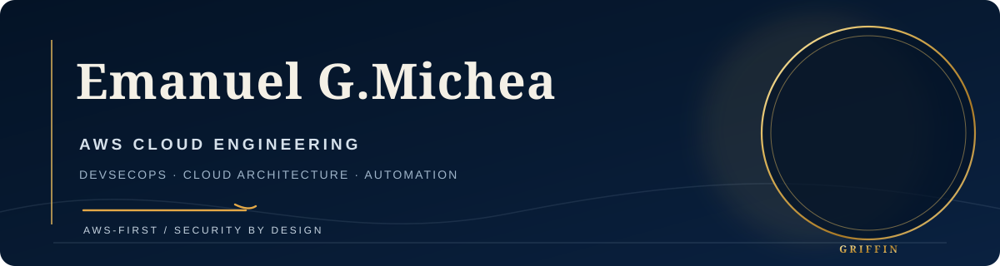

**CLOUD & DEVSECOPS ENGINEER**  
AWS · Cloud Infrastructure · Automation · Security by Design

[English](https://github.com/Emanuelgm98/Emanuelgm98) · [Español](https://github.com/Emanuelgm98/Emanuelgm98/blob/main/docs/README.es.md)

 &nbsp;
 &nbsp;

📍 Chile

---

I build and secure cloud infrastructure with an **AWS-first approach**, combining infrastructure as code, DevSecOps practices and automation. My focus is on practical, maintainable solutions with clear security controls and operational visibility.

## Core capabilities

| Area | Technologies and practices |
|---|---|
| **Cloud** | AWS · VPC · IAM · EC2 · S3 · RDS · Lambda · CloudWatch |
| **Infrastructure as Code** | Terraform · OpenTofu · CloudFormation |
| **Containers** | Docker · Kubernetes · Amazon EKS |
| **DevOps & CI/CD** | GitHub Actions · Git · Linux · PowerShell |
| **Cloud security** | IAM least privilege · Zero Trust · secrets management · DevSecOps |
| **Automation & development** | Python · JavaScript · Node.js · n8n · Playwright |
| **AI-assisted engineering** | Codex · Claude · human-in-the-loop workflows |

## Featured work

### Vanguard Private Operations
A private-operations concept supported by cloud-oriented architecture, secure workflows and automation.

- [Project presentation](https://emanuelgm98.github.io/Vanguard-presentation/)
- [Presentation source repository](https://github.com/Emanuelgm98/Vanguard-presentation)

### Cloud & DevSecOps portfolio
Hands-on work around AWS architecture, infrastructure automation, CI/CD security and operational practices.

[Explore my public repositories →](https://github.com/Emanuelgm98?tab=repositories)

## Certifications

- **AWS Certified Developer – Associate** — Amazon Web Services
- **CompTIA Security+ ce** — CompTIA

**Currently preparing:** AWS Certified Solutions Architect – Associate (SAA-C03).

## Education & professional development

**Higher Technical Degree in Cloud Administration** — Instituto Profesional IPP, Chile.

Additional verified training and badges across AWS Training, The Linux Foundation, Cisco and ISC2, including Kubernetes, GitOps, OpenTelemetry, software supply-chain security, Zero Trust and cybersecurity.

[View verified credentials on Credly](https://www.credly.com/users/emanuel-gonzalez.f52e9a04/badges)

## Contact

- **LinkedIn:** [emanuel-gonzalez-michea](https://www.linkedin.com/in/emanuel-gonzalez-michea/)
- **GitHub:** [@Emanuelgm98](https://github.com/Emanuelgm98)
- **Credly:** [Verified badges](https://www.credly.com/users/emanuel-gonzalez.f52e9a04/badges)

---

Cloud engineering · Security by design · Continuous improvement

