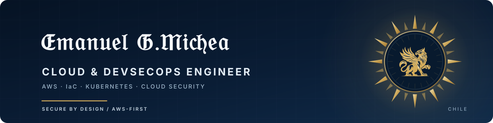
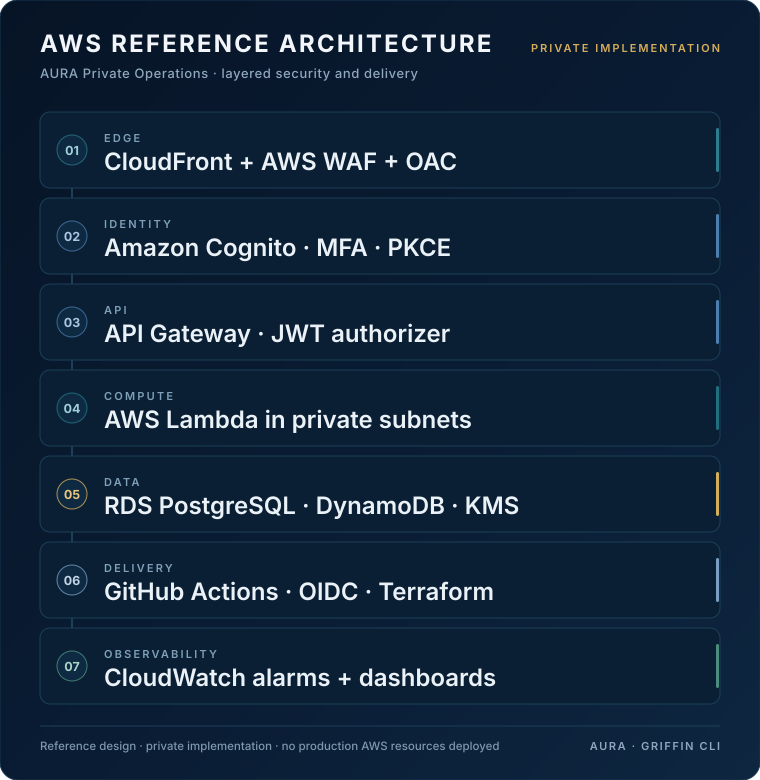
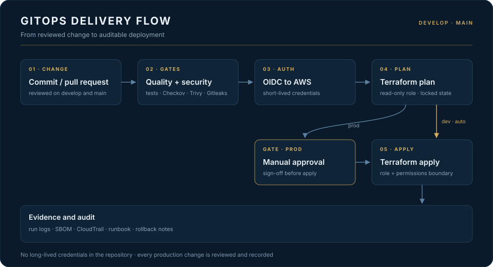

 

**CLOUD &amp; DEVSECOPS ENGINEER**  
AWS · INFRASTRUCTURE AS CODE · KUBERNETES · CLOUD SECURITY

[English](https://github.com/Emanuelgm98/Emanuelgm98) · [Español](https://github.com/Emanuelgm98/Emanuelgm98/blob/main/docs/README.es.md)

[LinkedIn](https://www.linkedin.com/in/emanuel-gonzalez-michea/) · [GitHub](https://github.com/Emanuelgm98) · [Credly](https://www.credly.com/users/emanuel-gonzalez.f52e9a04/badges)

---

## Profile

I design and automate secure AWS infrastructure with an **AWS-first** approach: private-by-default networks, least-privilege identity, infrastructure as code, GitOps delivery and security controls integrated into CI/CD.

My work focuses on turning cloud operations into reproducible, auditable systems — not one-off console changes.

**Open to:** Cloud Engineer · AWS Cloud Engineer · DevSecOps · Cloud Security  
**Based in:** Chile · remote and international teams

## What I bring

| Area | What I do |
| --- | --- |
| **Cloud architecture** | Design AWS environments with private networking, least-privilege IAM, encryption and managed services. |
| **Infrastructure as code** | Build reusable Terraform modules with remote state, locking, environment separation and policy-as-code. |
| **Secure delivery** | Integrate dependency, IaC and image scanning, SBOM, OIDC and protected production approvals into CI/CD. |
| **Operations** | Automate diagnostics and runbooks, define observability, and document backup, recovery and incident response. |

## Certifications

Active, publicly verifiable credentials:

|  |  |
|:--:|:--:|
| **CompTIA Security+ ce** CompTIA Valid through December 2028 | **AWS Certified Developer – Associate** Amazon Web Services Valid through January 2027 |

**Education:** Técnico de Nivel Superior en Administración en la Nube — IPP, Chile.  
**Continuous learning:** AWS architecture, Kubernetes, GitOps, supply-chain security and Zero Trust.

[Verify both credentials on Credly →](https://www.credly.com/users/emanuel-gonzalez.f52e9a04/badges)

## Technology stack

| Area | Technologies |
| --- | --- |
| **AWS services** | EC2 · ECS · EKS · S3 · IAM · VPC · CloudFormation · CloudWatch · Security Hub |
| **Security engineering** | Least privilege · Zero Trust · secrets management · vulnerability management · SBOM |
| **Delivery** | CI/CD · GitOps · infrastructure testing · policy-as-code |

## AWS architecture

Reference architecture from **AURA Private Operations**, a private commission operations platform built as a validated GitOps scaffold. The implementation is private; the public presentation (published as **Vanguard**) explains the product without exposing the operational console.

| Well-Architected pillar | Design decision |
| --- | --- |
| **Security** | CloudFront + WAF + OAC; Cognito MFA and PKCE; JWT authorizer; Lambda in private subnets; KMS encryption; OIDC roles with a permissions boundary. |
| **Reliability** | Private RDS PostgreSQL with backups and point-in-time recovery; multi-AZ in production; immutable ledger; documented recovery runbook. |
| **Operational excellence** | Terraform modules; plan/apply separation; automatic dev delivery; manual production approval; forward-only migrations from inside the VPC. |
| **Performance efficiency** | Static frontend delivered by CloudFront; serverless API; reserved concurrency; managed data services. |
| **Cost optimization** | Serverless and managed services; right-sized RDS; documented cost model and savings levers. |

> **Status:** the scaffold is validated locally. No production AWS resources are deployed; any `apply` requires explicit authorization and runs only from GitHub Actions with OIDC.

## Featured work

### 01 · AURA Private Operations

**Private source · Public presentation as Vanguard**

Commission operations and settlement platform designed around an immutable ledger, exact decimal arithmetic in PostgreSQL, strong identity and a pipeline that does not allow changes outside Git. The frontend is a static Next.js export on private S3 behind CloudFront OAC and WAF; the API is serverless inside a private VPC.

- **Security:** Cognito with mandatory MFA, OAuth2 PKCE, JWT authorizer, KMS, private subnets, idempotency and least-privilege OIDC roles.
- **Delivery:** Terraform modules, remote state with locking, Checkov/Trivy/Gitleaks gates, SBOM, automatic dev deployment and manual production approval.
- **Evidence:** architecture, runbook, disaster recovery, privacy, security and cost documents maintained with the private source.

[Public presentation](https://emanuelgm98.github.io/Vanguard-presentation/) · [Presentation source](https://github.com/Emanuelgm98/Vanguard-presentation)

### 02 · GRIFFIN CLI Agent

**Private source · Public guide**

Cross-platform installer and operations layer that connects Codex CLI with Telegram through Ductor. It pins tool versions and hashes, limits Telegram users, includes diagnostics and a usage/continuity monitor, and keeps full-access mode opt-in.

- **Security:** allow-listed Telegram users, local-only bot token, TLS checks, pinned versions and hashes, explicit warning for full-access mode.
- **Operations:** Windows visual installer, macOS/Linux scripts, service control, doctor checks, and an uninstall path that preserves user data.
- **Validation:** unit tests, compile checks, JSON validation and diff checks documented in the private repository.

[Public guide](https://codex-telegram-agent.vercel.app/)

### 03 · Profile design system

**Public**

Hand-authored SVG banners and diagrams, semantic Markdown and a responsive layout with no external trackers, animations or third-party stat widgets. Every asset is versioned with the profile and renders on GitHub mobile and desktop.

[Source](https://github.com/Emanuelgm98/Emanuelgm98)

## DevSecOps & security

Security is a delivery requirement, not a final checklist.

| Control area | Implementation |
| --- | --- |
| **Identity** | Least-privilege IAM, OIDC instead of static keys, MFA, role separation and permissions boundaries. |
| **Network** | Private subnets, security groups without implicit trust, private endpoints and edge protection with WAF. |
| **Data** | KMS encryption at rest, TLS in transit, secrets management, backups and recovery. |
| **Supply chain** | Pinned dependencies and actions, dependency review, IaC and image scanning, SBOM. |
| **Delivery** | Plan/apply separation, protected environments, manual production approval and audit trail. |
| **Operations** | Structured logs, alarms, dashboards, runbooks and documented disaster recovery. |

## GitOps & CI/CD

| Branch | Environment | Behavior |
| --- | --- | --- |
| `develop` | `dev` | Tests, scans, plan and automatic apply. |
| `main` | `prod` | Tests, scans and plan; manual approval before apply. |
| Pull request | — | Validation and plan only; never apply. |

No long-lived AWS credentials are stored in GitHub. Workflows exchange a short-lived OIDC token for temporary credentials, and production changes require an explicit approval.

## Activity & public evidence

Most of my engineering work lives in private repositories, so commit graphs and contribution counters do not represent the actual scope. I keep the public footprint intentional and verifiable:

- [AURA public presentation](https://emanuelgm98.github.io/Vanguard-presentation/) — product, capabilities and security model.
- [GRIFFIN public guide](https://codex-telegram-agent.vercel.app/) — installation, operations and security.
- [GitHub repositories](https://github.com/Emanuelgm98?tab=repositories) — public work and profile assets.
- [Credly](https://www.credly.com/users/emanuel-gonzalez.f52e9a04/badges) — verified certifications.

**Current focus:** secure AWS platforms · supply-chain security · Kubernetes and GitOps · AI-assisted operations with human approval.

## Contact

Open to Cloud Engineer, AWS Cloud Engineer, DevSecOps and Cloud Security roles. Based in Chile; available for remote and international teams.

[LinkedIn](https://www.linkedin.com/in/emanuel-gonzalez-michea/) · [GitHub](https://github.com/Emanuelgm98) · [Credly](https://www.credly.com/users/emanuel-gonzalez.f52e9a04/badges)

---

Cloud architecture · Security by design · Operational excellence

