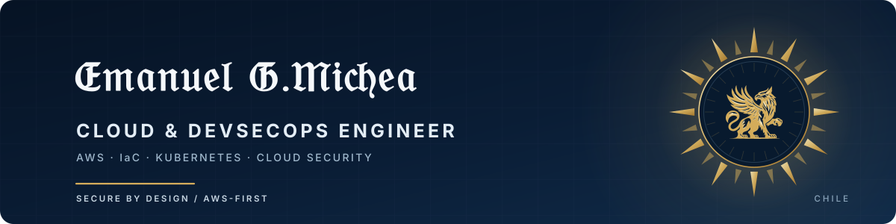
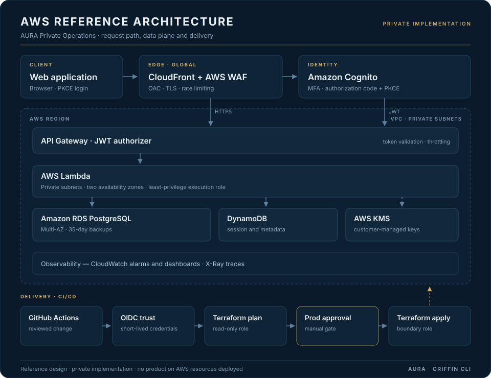
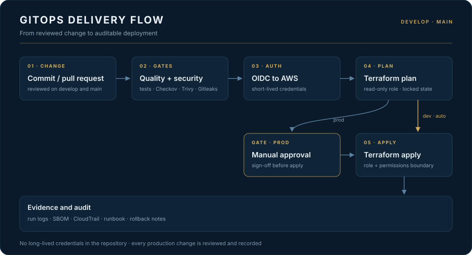

 

**INGENIERO CLOUD &amp; DEVSECOPS**  
AWS · INFRAESTRUCTURA COMO CÓDIGO · KUBERNETES · SEGURIDAD CLOUD

[Español](https://github.com/Emanuelgm98/Emanuelgm98/blob/main/docs/README.es.md) · [English](https://github.com/Emanuelgm98/Emanuelgm98)

&nbsp;&nbsp;&nbsp;&nbsp;&nbsp;&nbsp;

---

## Perfil

Diseño y automatizo infraestructura AWS segura con un enfoque **AWS-first**: redes privadas por defecto, identidad de mínimo privilegio, infraestructura como código, entrega GitOps y controles de seguridad integrados en CI/CD.

Mi trabajo busca convertir la operación cloud en sistemas reproducibles y auditables, no en cambios manuales de consola.

**Abierto a:** Cloud Engineer · AWS Cloud Engineer · DevSecOps · Cloud Security  
**Ubicación:** Chile · equipos remotos e internacionales

## Lo que aporto

- **Arquitectura cloud:** Diseñar entornos AWS con redes privadas, IAM de mínimo privilegio, cifrado y servicios gestionados.
- **Infraestructura como código:** Construir módulos Terraform reutilizables con estado remoto, bloqueo, separación de entornos y policy-as-code.
- **Entrega segura:** Integrar escaneo de dependencias, IaC e imágenes, SBOM, OIDC y aprobaciones protegidas en CI/CD.
- **Operación:** Automatizar diagnósticos y runbooks, definir observabilidad y documentar backup, recuperación y respuesta a incidentes.

## Certificaciones

Credenciales activas y verificables públicamente:

&nbsp;&nbsp;&nbsp;

<strong>CompTIA Security+ ce</strong> · CompTIA · vigente hasta diciembre de 2028 
<strong>AWS Certified Developer – Associate</strong> · Amazon Web Services · vigente hasta enero de 2027

**Formación:** Técnico de Nivel Superior en Administración en la Nube — IPP, Chile.  
**Aprendizaje continuo:** arquitectura AWS, Kubernetes, GitOps, seguridad de la cadena de suministro y Zero Trust.

[Ver ambas credenciales en Credly →](https://www.credly.com/users/emanuel-gonzalez.f52e9a04/badges)

## Stack tecnológico

- **Servicios AWS:** EC2 · ECS · EKS · S3 · IAM · VPC · CloudFormation · CloudWatch · Security Hub
- **Ingeniería de seguridad:** Mínimo privilegio · Zero Trust · gestión de secretos · gestión de vulnerabilidades · SBOM
- **Entrega:** CI/CD · GitOps · pruebas de infraestructura · policy-as-code

## Arquitectura AWS

Arquitectura de referencia de **AURA Private Operations**, una plataforma privada de operaciones y liquidación de comisiones construida como scaffold GitOps validado. La implementación es privada; la presentación pública (publicada como **Vanguard**) explica el producto sin exponer la consola operativa.

- **Seguridad:** CloudFront + WAF + OAC; Cognito con MFA y PKCE; authorizer JWT; Lambda en subredes privadas; cifrado KMS; roles OIDC con permissions boundary.
- **Fiabilidad:** RDS PostgreSQL privado con backups y point-in-time recovery; multi-AZ en producción; ledger inmutable; runbook de recuperación documentado.
- **Excelencia operativa:** Módulos Terraform; separación plan/apply; entrega automática a dev; aprobación manual en producción; migraciones forward-only desde la VPC.
- **Eficiencia de rendimiento:** Frontend estático en CloudFront; API serverless; concurrencia reservada; servicios de datos gestionados.
- **Optimización de costos:** Servicios serverless y gestionados; RDS dimensionado; modelo de costos y palancas de ahorro documentados.

> **Estado:** el scaffold está validado localmente. No se han desplegado recursos AWS de producción; cualquier `apply` requiere autorización explícita y se ejecuta solo desde GitHub Actions con OIDC.

## Proyectos destacados

### 01 · AURA Private Operations

**Código privado · Presentación pública como Vanguard**

Plataforma de operaciones y liquidación de comisiones diseñada con un ledger inmutable, aritmética decimal exacta en PostgreSQL, identidad fuerte y un pipeline que no permite cambios fuera de Git. El frontend es un export estático de Next.js en S3 privado detrás de CloudFront OAC y WAF; la API es serverless dentro de una VPC privada.

- **Seguridad:** Cognito con MFA obligatorio, OAuth2 PKCE, authorizer JWT, KMS, subredes privadas, idempotencia y roles OIDC de mínimo privilegio.
- **Entrega:** módulos Terraform, estado remoto con bloqueo, controles Checkov/Trivy/Gitleaks, SBOM, despliegue automático a dev y aprobación manual en producción.
- **Evidencia:** documentos de arquitectura, runbook, recuperación ante desastres, privacidad, seguridad y costos mantenidos junto al código privado.

[Presentación pública](https://emanuelgm98.github.io/Vanguard-presentation/) · [Código de la presentación](https://github.com/Emanuelgm98/Vanguard-presentation)

### 02 · GRIFFIN CLI Agent

**Código privado · Guía pública**

Instalador y capa de operación multiplataforma que conecta Codex CLI con Telegram mediante Ductor. Fija versiones y hashes de herramientas, limita los usuarios de Telegram, incluye diagnóstico y un monitor de uso y continuidad, y mantiene el modo de acceso completo como opción explícita.

- **Seguridad:** usuarios de Telegram en lista blanca, token del bot solo local, comprobaciones TLS, versiones y hashes fijados, advertencia explícita para el modo de acceso completo.
- **Operación:** instalador visual para Windows, scripts para macOS/Linux, control del servicio, comprobaciones de diagnóstico y desinstalación que conserva los datos del usuario.
- **Validación:** pruebas unitarias, compilación, validación JSON y comprobaciones de diff documentadas en el repositorio privado.

[Guía pública](https://codex-telegram-agent.vercel.app/)

### 03 · Sistema de diseño del perfil

**Público**

Banners y diagramas SVG escritos a mano, Markdown semántico y un diseño adaptable sin rastreadores externos, animaciones ni widgets de estadísticas de terceros. Cada recurso se versiona con el perfil y se renderiza en GitHub móvil y escritorio.

[Código](https://github.com/Emanuelgm98/Emanuelgm98)

## DevSecOps y seguridad

La seguridad es un requisito de entrega, no una lista de verificación final.

- **Identidad:** IAM de mínimo privilegio, OIDC en lugar de claves estáticas, MFA, separación de roles y permissions boundaries.
- **Red:** Subredes privadas, security groups sin confianza implícita, endpoints privados y protección perimetral con WAF.
- **Datos:** Cifrado KMS en reposo, TLS en tránsito, gestión de secretos, backups y recuperación.
- **Cadena de suministro:** Dependencias y actions fijadas, revisión de dependencias, escaneo de IaC e imágenes, SBOM.
- **Entrega:** Separación plan/apply, entornos protegidos, aprobación manual en producción y trazabilidad de auditoría.
- **Operación:** Logs estructurados, alarmas, dashboards, runbooks y recuperación ante desastres documentada.

## GitOps y CI/CD

- **`develop` → `dev`:** Pruebas, escaneos, plan y apply automático.
- **`main` → `prod`:** Pruebas, escaneos y plan; aprobación manual antes del apply.
- **Pull request:** Solo validación y plan; nunca apply.

No se almacenan credenciales AWS de larga duración en GitHub. Los workflows intercambian un token OIDC de corta duración por credenciales temporales, y los cambios de producción requieren aprobación explícita.

## Actividad y evidencia pública

La mayor parte de mi trabajo de ingeniería está en repositorios privados, por lo que los gráficos de commits y contadores de contribuciones no representan el alcance real. Mantengo una huella pública intencional y verificable:

- [Presentación pública de AURA](https://emanuelgm98.github.io/Vanguard-presentation/) — producto, capacidades y modelo de seguridad.
- [Guía pública de GRIFFIN](https://codex-telegram-agent.vercel.app/) — instalación, operación y seguridad.
- [Repositorios de GitHub](https://github.com/Emanuelgm98?tab=repositories) — trabajo público y recursos del perfil.
- [Credly](https://www.credly.com/users/emanuel-gonzalez.f52e9a04/badges) — certificaciones verificadas.

**Enfoque actual:** plataformas AWS seguras · seguridad de la cadena de suministro · Kubernetes y GitOps · operaciones asistidas por IA con aprobación humana.

## Contacto

Abierto a roles de Cloud Engineer, AWS Cloud Engineer, DevSecOps y Cloud Security. Ubicado en Chile; disponible para equipos remotos e internacionales.

&nbsp;&nbsp;&nbsp;&nbsp;&nbsp;&nbsp;

---

Arquitectura cloud · Seguridad desde el diseño · Excelencia operativa

