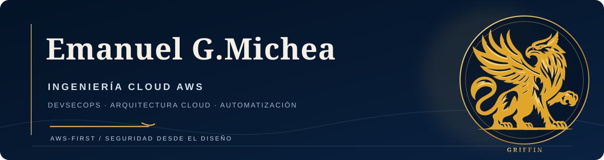

**INGENIERO CLOUD & DEVSECOPS**  
AWS · Arquitectura Cloud · Automatización · Seguridad desde el diseño

[Español](https://github.com/Emanuelgm98/Emanuelgm98/blob/main/docs/README.es.md) · [English](https://github.com/Emanuelgm98/Emanuelgm98)

[LinkedIn](https://www.linkedin.com/in/emanuel-gonzalez-michea/) · [GitHub](https://github.com/Emanuelgm98) · [Credly](https://www.credly.com/users/emanuel-gonzalez.f52e9a04/badges)

📍 Chile

---

Desarrollo y protejo infraestructura cloud con un **enfoque AWS-first**, integrando infraestructura como código, prácticas DevSecOps y automatización. Me centro en soluciones prácticas y mantenibles, con controles de seguridad claros y visibilidad operativa.

## Competencias principales

- **Cloud:** AWS, VPC, IAM, EC2, S3, RDS, Lambda, CloudWatch
- **Infraestructura como código:** Terraform, OpenTofu, CloudFormation
- **Contenedores:** Docker, Kubernetes, Amazon EKS
- **DevOps y CI/CD:** GitHub Actions, Git, Linux, PowerShell
- **Seguridad cloud:** IAM least privilege, Zero Trust, gestión de secretos, DevSecOps
- **Automatización y desarrollo:** Python, JavaScript, Node.js, n8n, Playwright
- **Ingeniería asistida por IA:** Codex, Claude, flujos con aprobación humana

## Proyectos destacados

### Vanguard Private Operations

Concepto de operaciones privadas respaldado por una arquitectura orientada a cloud, flujos seguros y automatización.

- [Ver presentación del proyecto](https://emanuelgm98.github.io/Vanguard-presentation/)
- [Repositorio de la presentación](https://github.com/Emanuelgm98/Vanguard-presentation)

### Portfolio Cloud & DevSecOps

Trabajo práctico en arquitectura AWS, automatización de infraestructura, seguridad CI/CD y operación cloud.

[Explorar mis repositorios públicos](https://github.com/Emanuelgm98?tab=repositories)

## Certificaciones

- **AWS Certified Developer – Associate** — Amazon Web Services
- **CompTIA Security+ ce** — CompTIA

**En preparación:** AWS Certified Solutions Architect – Associate (SAA-C03).

## Formación y desarrollo profesional

**Técnico de Nivel Superior en Administración en la Nube (Cloud)** — Instituto Profesional IPP, Chile.

Formación complementaria e insignias verificadas de AWS Training, The Linux Foundation, Cisco e ISC2, con contenidos de Kubernetes, GitOps, OpenTelemetry, seguridad de la cadena de suministro de software, Zero Trust y ciberseguridad.

[Ver credenciales verificadas en Credly](https://www.credly.com/users/emanuel-gonzalez.f52e9a04/badges)

## Ecosistema tecnológico

AWS es la plataforma cloud principal representada en mis proyectos de arquitectura e ingeniería. **GRIFFIN** es un proyecto independiente de automatización con agentes, enfocado en ejecución controlada, aprobaciones humanas y evidencia operativa. Se presentan como referencias tecnológicas y de proyectos, no como patrocinios oficiales.

## Contacto

- **LinkedIn:** [emanuel-gonzalez-michea](https://www.linkedin.com/in/emanuel-gonzalez-michea/)
- **GitHub:** [@Emanuelgm98](https://github.com/Emanuelgm98)
- **Credly:** [Insignias verificadas](https://www.credly.com/users/emanuel-gonzalez.f52e9a04/badges)

---

Ingeniería cloud · Seguridad desde el diseño · Mejora continua

